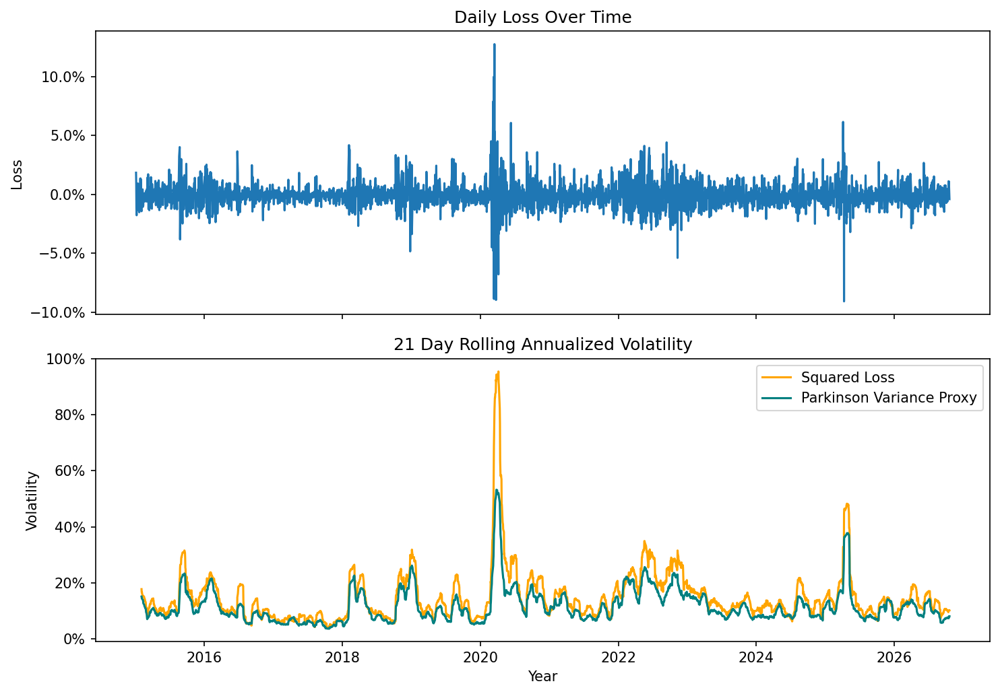
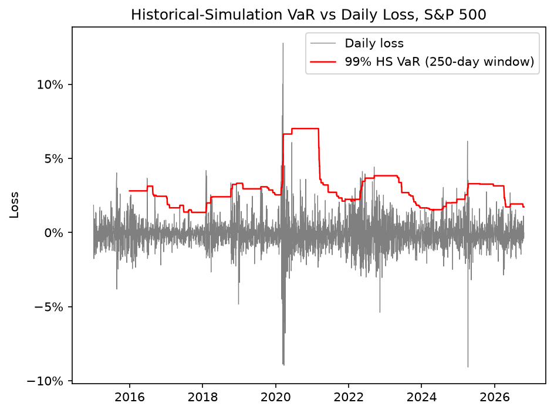

# Tail-Risk Forecasting

## Status
Work in progress. Done: data pipeline and checks, volatility proxies, historical-simulation VaR/ES with Kupiec backtest.
Next: Christoffersen independence test, GARCH and HAR-based VaR, conformal calibration and e-backtesting.

## Goal

Forecast 1-day Value-at-Risk (VaR) and Expected Shortfall (ES) for an equity index, calibrate them with conformal methods, and evaluate them with e-backtests.

## Data

Data consists of daily open, high, low and close prices for the S&P 500 index, sourced from Yahoo Finance via `yfinance`, from January 2015 to September 2026. Daily log returns are computed from the close price, and the loss is defined as the negative of the daily return, so that a positive value is a loss, the convention for VaR and ES.

Before any modelling, each price series is passed through `check_prices`, which counts missing values, non-positive prices, and days where the high is below the low, the close is outside the daily range, or the high equals the low (a sign of stale quotes), as well as duplicated or unordered dates. The S&P 500 sample passes all checks. Impossible rows (e.g. a high below the low) would be removed, but extreme returns are kept, because they are the most informative for risk management and test the limits of traditional VaR and ES methods.

A single squared daily return is an unbiased but very noisy measure of that day's variance. As a less noisy proxy, I also compute the range-based estimator of Parkinson (1980), as presented in Christoffersen (2012, Section 6.1). The estimator assumes normally distributed log returns with zero mean within the day, and only uses prices observed during trading hours.

$$\hat\sigma^2_t = \frac{1}{4\ln 2}\left(\ln\frac{H_t}{L_t}\right)^2$$

where $H_t$ and $L_t$ are the daily high and low.

The figure compares 21-day rolling annualised volatility from both measures. They follow the same regimes, but Parkinson is consistently lower, because the high–low range only covers trading hours and misses the overnight gap between the previous close and the open. This gap is largest in crises: in March 2020, close-to-close volatility reached about 95%, against roughly 53% for Parkinson. Extending the proxy with estimators that include the overnight return (Garman–Klass, Yang–Zhang) is a next step.

<p align="center">
  
</p>

## Method

### Baseline : Historical Simulation 

As a baseline, the next day 99% VaR and ES metrics are forecast using historical simulation.

Let $L_t = -\ln(P_t / P_{t-1})$ be the daily loss and $m = 250$ the window length. The one-day-ahead forecasts are

```math
\text{VaR}_{t+1}^{99\%} = \text{Percentile}\left(\lbrace L_\tau \rbrace_{\tau=t-m+1}^{t},\ 0.99\right)
```

```math
\text{ES}_{t+1}^{99\%} = \frac{\sum_{\tau=t-m+1}^{t} L_\tau \, \mathbf{1}\lbrace L_\tau \ge \text{VaR}_{t+1}^{99\%} \rbrace}{\sum_{\tau=t-m+1}^{t} \mathbf{1}\lbrace L_\tau \ge \text{VaR}_{t+1}^{99\%} \rbrace}
```

where $L_\tau$ is the daily loss, $m = 250$ the window length, and $\mathbf{1}\{\cdot\}$ the indicator function

## Results

### Historical simulation (S&P 500, Dec 2015 – Sep 2026, 2,702 days)

<p align="center">
  
</p>

*Daily losses (grey), the 99% historical-simulation VaR forecast (red), and the 43 days on which the loss exceeded VaR (dots). Violations cluster after volatility shocks.*


| Test | Statistic | p-value | Result |
|---|---|---|---|
| Violations | 43 observed vs 27.0 expected (1.59%) | | |
| Kupiec (unconditional coverage) | LR = 8.09 | 0.004 | Rejected |
| Christoffersen (independence) | LR = 12.17 | 0.0005 | Rejected |
| Conditional coverage | LR = 20.27 | 0.00004 | Rejected |


As expected, historical simulation fails the unconditional coverage, independence and conditional coverage tests. Extreme losses occur more often than the VaR model predicts, and they cluster over time: the probability of a violation is 1.4% after a day without one, but 11.6% after a day with one, about eight times higher. The 250-day window makes the model slow to react to volatility shocks. VaR is too low in the first days of a crisis, and then stays elevated for a full year until the shock leaves the window, overstating risk, where opportunity costs come into play. This motivates conditional volatility models such as GARCH, which update the volatility forecast every day using the latest returns.

## References

- Christoffersen, P. F. (1998). Evaluating interval forecasts. *International Economic Review*, 39(4), 841–862.
- Christoffersen, P. F. (2012). *Elements of Financial Risk Management* (2nd ed.). Academic Press.
- Kupiec, P. H. (1995). Techniques for verifying the accuracy of risk measurement models. *Journal of Derivatives*, 3(2), 73–84.
- Parkinson, M. (1980). The extreme value method for estimating the variance of the rate of return. *Journal of Business*, 53(1), 61–65.

