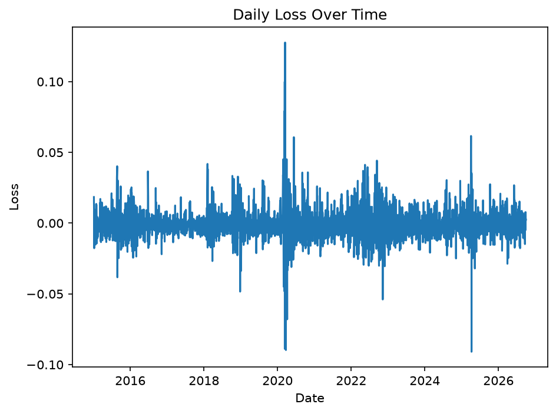
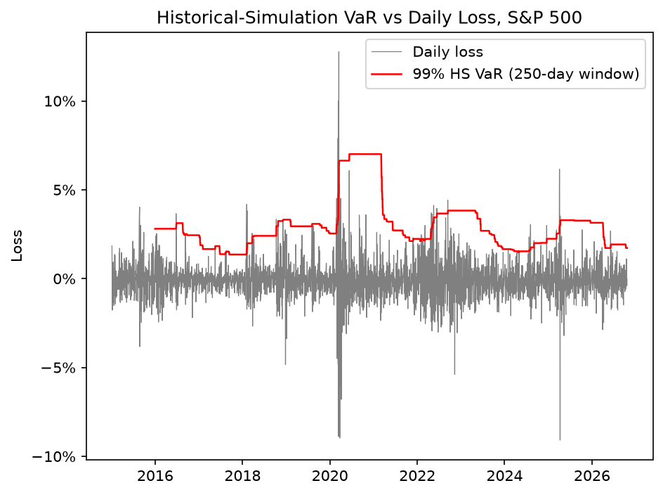
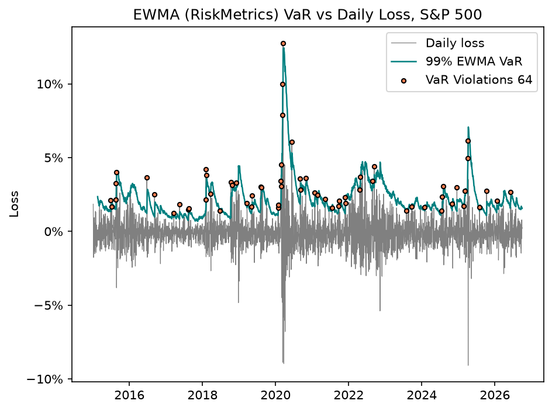
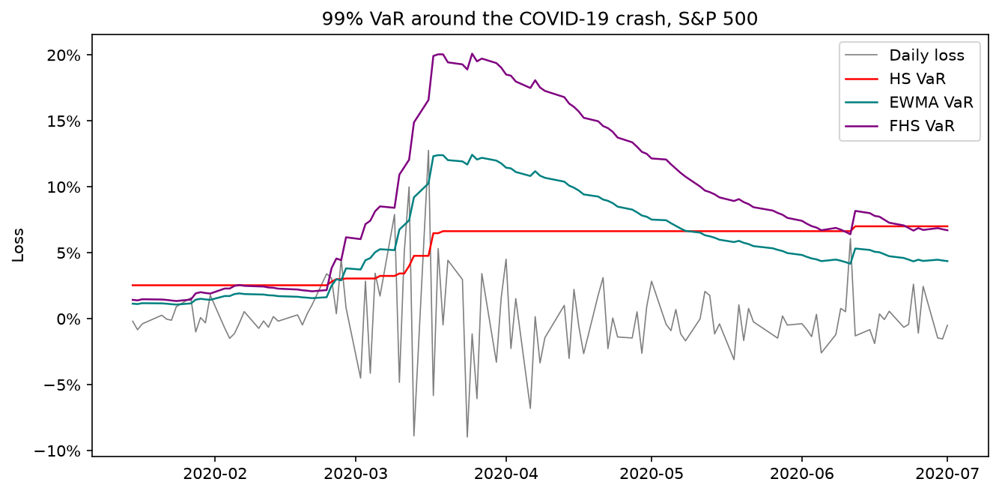
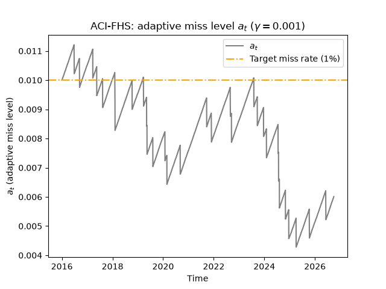
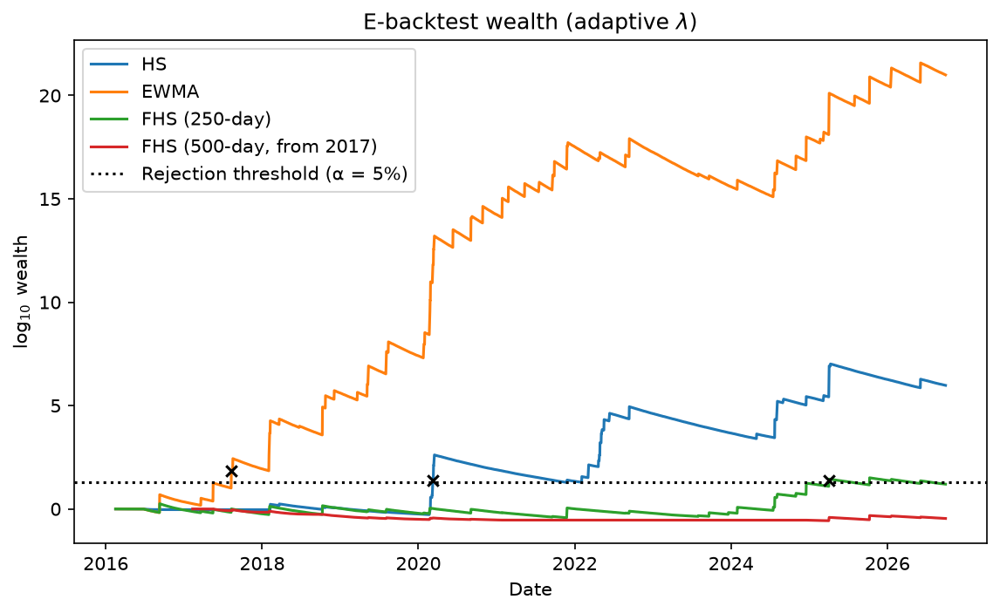

# Tail-Risk Forecasting

## Summary

### Research Question

*Which VaR and ES models are adequate for daily 99% risk on the S&P 500, can calibration fix the ones that aren’t, and how quickly can modern backtests detect a failing model?*

### Summary Results

| Model | Kupiec | Independence | Cond. coverage | ES (McNeil-Frey) | E-backtest (adaptive λ) |
|---|---|---|---|---|---|
| HS | Fail (0.004) | Fail (0.0005) | Fail (< 0.001) | Fail (0.005) | Rejected 9 Mar 2020 |
| EWMA | Fail (< 0.001) | Pass (0.191) | Fail (< 0.001) | Fail (< 0.001) | Rejected 10 Aug 2017 |
| FHS, 250-day | Pass (0.124) | Pass (0.086) | Pass (0.070) | Pass (0.232) | Rejected 3 Apr 2025*** |
| FHS, 500-day* | Pass (0.344) | Fail (0.049) | Pass (0.091) | Pass (0.710) | Never rejected |
| ACI-FHS, γ = 0.005** | Pass (0.921) | Pass (0.613) | Pass (0.876) | n/a | n/a |

\*2,422-day sample from 2017.\
\*\*Out-of-sample test half (from 7 Jun 2021), with infinite VaR on 91 of 1,336 days. ACI only adjusts the VaR level and gives no ES forecast, so the ES tests do not apply.\
\*\*\*Not rejected on the 2,422-day sample from 2017 (peak wealth 6.55).

### Answer

**Which models are adequate?** 

Only FHS holds up. HS and EWMA fail both the VaR and the ES tests. FHS with a 250-day window passes all four classic tests. A 500-day window gives a slightly conservative ES and is never rejected by the e-backtest, but its breaches are slightly clustered (independence p = 0.049).

**Can calibration fix them?**

Partly. ACI brings the breach rate close to 1% and passes all three VaR tests on the test half. The cost is an infinite VaR on 91 days, all in 2024-2025. It fixes the breach count, but not always with a usable risk number.

**How quickly can a failing model be detected?**

There is no true starting point, since we never know exactly when a model starts to fail. Speed can therefore only be judged against the shock that breaks it. EWMA is wrong from the start, because its normal tails never fit, and the e-backtest rejects it in August 2017. HS only breaks in a crash, and it is rejected on 9 March 2020, within weeks of the COVID sell-off. 

Importantly, the classic tests only give a verdict at the end of the sample. The e-backtest can stop as soon as the evidence is strong enough, and that result stays valid. It also rejects FHS-250 in April 2025, so even the best model shows weakness in its ES after a large shock.

### Limitations

- This project analyses only one index and one coverage level. 
- The $\lambda$ chosen for the EWMA approach is 0.94, the one recommended in the RiskMetrics model. This choice may have an effect on results as it is not estimated from the data. 
- ACI gives an infinite VaR on 91 of 1,336 days. This keeps the coverage level, but an infinite VaR is unrealistic in practice.
- McNeil-Frey only uses breach days, running on 29-59 observations. With so few observations, the test has low power, so a weak ES model can still pass. The bootstrap helps, but it doesn’t add any new data. The e-backtest uses every day, not only breach days.


## Data

Data consists of daily open, high, low and close prices for the S&P 500 index, sourced from Yahoo Finance via `yfinance`, from January 2015 to September 2026. Daily log returns are computed from the close price, and the loss is defined as the negative of the daily return, so that a positive value is a loss, the convention for VaR and ES.

Before any modelling, each price series is passed through `check_prices`, which counts missing values, non-positive prices, and days where the high is below the low, the close is outside the daily range, or the high equals the low (a sign of stale quotes), as well as duplicated or unordered dates. The S&P 500 sample passes all checks. Impossible rows (e.g. a high below the low) would be removed, but extreme returns are kept, because they are the most informative for risk management and test the limits of traditional VaR and ES methods.

<p align="center">
  
</p>

The figure shows the daily losses over the sample. Large losses cluster in time, most clearly around the COVID-19 crash in March 2020 and the sell-off in April 2025. Calm periods alternate with stressed ones, which is the behaviour a good VaR model must capture.

## Method

### Baseline: Historical Simulation 

As a baseline, the next-day 99% VaR and ES metrics are forecast using historical simulation.

Let $L_t = -\ln(P_t / P_{t-1})$ be the daily loss and $m = 250$ the window length. The one-day-ahead forecasts are

```math
\text{VaR}_{t+1}^{99\%} = \text{Percentile}\left(\lbrace L_\tau \rbrace_{\tau=t-m+1}^{t},\ 0.99\right)
```

```math
\text{ES}_{t+1}^{99\%} = \frac{\sum_{\tau=t-m+1}^{t} L_\tau \, \mathbf{1}\lbrace L_\tau \ge \text{VaR}_{t+1}^{99\%} \rbrace}{\sum_{\tau=t-m+1}^{t} \mathbf{1}\lbrace L_\tau \ge \text{VaR}_{t+1}^{99\%} \rbrace}
```

where $\mathbf{1}\{\cdot\}$ is the indicator function.

### Exponentially Weighted Moving Average (RiskMetrics)

To capture volatility clustering, I add the RiskMetrics model. One-day-ahead variance forecasts are updated as

```math
\sigma_{t+1}^2 = \lambda\,\sigma_t^2 + (1-\lambda)\,L_t^2, \qquad \lambda = 0.94
```

The variance is initialised with the sample variance of the first 30 losses. Assuming normally distributed losses, VaR and ES follow from the inverse of the standard normal CDF (`norm.ppf`) and the standard normal density (`norm.pdf`):

```math
\text{VaR}_{t+1}^{99\%} = \sigma_{t+1}\,\Phi^{-1}_{0.99}
```

```math
\text{ES}_{t+1}^{99\%} = \sigma_{t+1}\,\frac{\phi\big(\Phi^{-1}_{0.99}\big)}{0.01}
```

### Filtered historical simulation (FHS)

The filtered historical simulation combines the EWMA volatility estimate with the empirical distribution of the standardised losses. This keeps the fast reaction to volatility of the EWMA model, without assuming that losses are normally distributed. First, each loss is standardised by its volatility estimate:

```math
z_\tau = \frac{L_\tau}{\sigma_\tau}
```

Thereafter, the empirical 99% quantile of the past 250 standardised losses is computed:

```math
\hat{q}_{t+1} = \text{Percentile}\left(\lbrace z_\tau \rbrace_{\tau=t-m+1}^{t},\ 0.99\right)
```

VaR and ES are then obtained by scaling the empirical quantile and tail mean of the standardised losses with the EWMA volatility forecast:

```math
\text{VaR}_{t+1}^{99\%} = \sigma_{t+1}\,\hat{q}_{t+1}
```

```math
\text{ES}_{t+1}^{99\%} = \sigma_{t+1}\,\frac{\sum_{\tau=t-m+1}^{t} z_\tau\,\mathbf{1}\lbrace z_\tau \ge \hat{q}_{t+1}\rbrace}{\sum_{\tau=t-m+1}^{t} \mathbf{1}\lbrace z_\tau \ge \hat{q}_{t+1}\rbrace}
```

### Adaptive Conformal Calibration (ACI)
 
Adaptive conformal inference is used to dynamically adjust the coverage level after each day as:

```math
a_{t+1} = a_{t} + \gamma((1 - p) - hit_{t}), \qquad a_1 = 1 - p
```

where $hit_t = 1 \space\text{if}\space L_t > VaR_t \space\text{else}\space 0$, $\gamma$ is the step size, and $p = 0.99$ is the confidence level.  

Thus, breaches make the VaR more conservative and calm periods relax it. In addition, values $a_t \le 0$ are allowed and result in an infinite VaR. Clipping them would break the long-run coverage guarantee. 

#### VaR Calculation

- ACI-EWMA: $VaR_t = \sigma_t \times \Phi^{-1}(1-a_t)$
- ACI-FHS: $VaR_t = \sigma_t \times \text{Quantile}\left(\lbrace z_\tau \rbrace_{\tau=t-250}^{t-1}, \space 1-a_t\right)$

#### Out-of-sample choice of $\gamma$

To test whether the ACI results depend on choosing $\gamma$ after seeing the backtest, an additional robustness check is conducted in which the rule for choosing this parameter is fixed in advance. More explicitly, the sample is split in half on 7 June 2021, and $\gamma$ is chosen on the first half as the value that produces no infinite-VaR days and a breach rate closest to 1%. This choice is then evaluated on the second half of the sample only. Because ACI updates on a daily basis using only past data, its forecasts in the first half do not depend on the second half.

### McNeil-Frey Expected Shortfall Backtest

VaR backtests only check how often losses exceed VaR, not how large those losses are. To test whether the models also capture the size of tail losses, I use the exceedance residual test of McNeil and Frey (2000).

The test is relatively simple, and only needs the VaR, ES and volatility forecasts already computed above. On each breach day, the exceedance residual is computed:

```math
r_t = \frac{L_t - ES_t}{\sigma_t}
```

where $L_t$ is the loss on day $t$, $ES_t$ is the model's Expected Shortfall forecast, and $\sigma_t$ is the model's volatility forecast for that day: the EWMA volatility for EWMA and FHS, and a rolling 250-day standard deviation of past losses for HS. The residual is only computed on breach days, defined as days with $L_t > VaR_t$.

If the ES is correctly estimated, there are no deviations from it on average, thus the mean of the exceedance residuals $r_t$ should be 0. A positive mean indicates that ES is underestimated, therefore a one-tailed t-test is used to verify discrepancies.

```math
\begin{align}
  H_0: \mathbb{E}[r_t] = 0 \\
  H_1: \mathbb{E}[r_t] > 0
\end{align}
```

The test statistic is

```math
t = \frac{\bar{r}}{s_r / \sqrt{n}}
```

where $\bar{r}$ and $s_r$ are the mean and standard deviation of the residuals and $n$ is the number of breaches. Under $H_0$ it follows a t-distribution with $n - 1$ degrees of freedom.

### E-Backtesting

McNeil-Frey only gives one p-value for an entire sample. This is often not desirable, as a failing model must be detected as soon as possible. An e-backtest, following Wang, Wang and Ziegel (2025), builds evidence day-by-day and can reject a model at any point in time, which is what a risk manager who monitors a model live needs.

E-backtesting is similar to betting a portion of our wealth against our model each day. The payoff of this bet is the e-value:

$$e_t = \frac{(L_t - \mathrm{VaR}_t)^+}{(1-p)\,(\mathrm{ES}_t - \mathrm{VaR}_t)}$$

where $L_t$ is the loss on day $t$, $\mathrm{VaR}_t$ and $\mathrm{ES}_t$ are the model's forecasts, $p = 0.99$ is the confidence level, and $(x)^+ = \max(x, 0)$. If VaR and ES are correct, the expected value of $e_t$ is at most 1, so the bet cannot win on average. If the model underestimates the tail, the bet wins and our wealth grows.

The wealth process of this betting strategy is:

$$M_t = M_{t-1}\,\big(1 - \lambda + \lambda\, e_t\big), \qquad M_0 = 1$$

where $\lambda$ is the portion of wealth bet each day (not to be confused with the EWMA decay factor), with rejection at the first $t$ where $M_t \geq 1/\alpha$. With $\alpha = 0.05$, the threshold is 20.

By Ville's inequality, this keeps the false-rejection probability at or below $\alpha$, even though the wealth is checked every day.


#### Adaptive $\lambda$

A fixed $\lambda$ is an arbitrary choice, and has a strong influence on results. Thus, following Wang, Wang and Ziegel (2025), an additional method is introduced. Here, $\lambda$ is chosen each day as the value that would have maximised the wealth growth on past e-values.

```math
\lambda_t =  \arg\max_{\lambda\in[0,0.5]}\sum_{s<t}\log(1-
\lambda+\lambda e_s)
```

Importantly, since $\lambda_t$ uses only the past, the false-rejection guarantee is kept.

## Results

### Historical simulation (S&P 500, Dec 2015 - Sep 2026, 2,702 days)

<p align="center">
  
</p>

*Daily losses (grey), the 99% historical-simulation VaR forecast (red), and the 43 days on which the loss exceeded VaR (dots). Violations cluster after volatility shocks.*


| Test | Statistic | p-value | Result |
|---|---|---|---|
| Violations | 43 observed vs 27.0 expected (1.59%) | | |
| Kupiec (unconditional coverage) | LR = 8.09 | 0.004 | Rejected |
| Christoffersen (independence) | LR = 12.17 | 0.0005 | Rejected |
| Conditional coverage | LR = 20.27 | 0.00004 | Rejected |


As expected, historical simulation fails the unconditional coverage, independence and conditional coverage tests. Extreme losses occur more often than the VaR model predicts, and they cluster over time: the probability of a violation is 1.4% after a day without one, but 11.6% after a day with one, about eight times higher. The 250-day window makes the model slow to react to volatility shocks. VaR is too low in the first days of a crisis, and then stays elevated for a full year until the shock leaves the window, overstating risk, where opportunity costs come into play. This motivates conditional volatility models such as GARCH, which update the volatility forecast every day using the latest returns.


### Exponentially Weighted Moving Average (S&P 500, Dec 2015 - Sep 2026, 2,702 days)

<p align="center">
  
</p>

*Daily losses (grey), the 99% EWMA VaR forecast (teal), and the days on which the loss exceeded VaR (dots).*

| | Historical simulation | EWMA (RiskMetrics) |
|---|---|---|
| Violations (expected 27.0) | 43 (1.59%) | 59 (2.18%) |
| Kupiec (unconditional coverage) | LR = 8.09, p = 0.004, rejected | LR = 28.58, p < 0.001, rejected |
| Christoffersen (independence) | LR = 12.17, p = 0.0005, rejected | LR = 1.75, p = 0.19, **not rejected** |
| Conditional coverage | LR = 20.27, p < 0.001, rejected | LR = 30.33, p < 0.001, rejected |

Both models are evaluated on the same sample of 2,702 days. As expected, since EWMA is a special case of GARCH(1,1), the model captures volatility clustering: VaR rises immediately after a shock, and the independence test is no longer rejected. On the other hand, EWMA breaches its VaR far more often than expected, on 2.18% of days instead of 1%. This is due to the fatter tails of equity losses, which make the 99% quantile of the normal distribution (about 2.33 standard deviations) too low for a reliable forecast. Therefore, EWMA fixes when VaR reacts, but not how far into the tail it reaches. This motivates filtered historical simulation, which keeps the EWMA volatility but replaces the normal quantile with the empirical quantile of standardised losses.


### Model comparison: HS, EWMA and FHS (Feb 2016 - Sep 2026, 2,672 days)

All three models are evaluated on the same sample of 2,672 days, starting once every model has a full estimation window. The historical-simulation figures therefore differ slightly from the section above.

| | Historical simulation | EWMA (RiskMetrics) | FHS |
|---|---|---|---|
| Violations (expected 26.7) | 43 (1.61%) | 59 (2.21%) | 35 (1.31%) |
| Kupiec (unconditional coverage) | LR = 8.46, p = 0.004, rejected | LR = 29.31, p < 0.001, rejected | LR = 2.36, p = 0.124, not rejected |
| Christoffersen (independence) | LR = 12.07, p = 0.0005, rejected | LR = 1.71, p = 0.191, not rejected | LR = 2.95, p = 0.086, not rejected |
| Conditional coverage | LR = 20.53, p < 0.001, rejected | LR = 31.02, p < 0.001, rejected | LR = 5.31, p = 0.070, not rejected |

<p align="center">
  
</p>

*Daily losses and the 99% VaR forecasts of the three models around the COVID-19 crash in March 2020.*

As expected, historical simulation fails all three tests: it reacts too slowly to volatility shocks, so its violations are both too frequent and clustered. The EWMA model solves the clustering, since the independence test is no longer rejected, but it breaches its VaR on 2.2% of days instead of 1%. This is due to the fatter tails of equity losses, which the normal distribution underestimates. Filtered historical simulation combines the strengths of both models: it keeps the fast reaction of EWMA to volatility, while the empirical quantile of the standardised losses captures the fat tails. As a result, FHS is the only model that passes all three tests at the 5% level. However, the independence test is borderline (p = 0.086) and the number of violations remains somewhat above the expected 26.7, so some clustering and tail risk remain.

### Robustness: RiskMetrics decay factor and window length

To check whether the FHS results depend on the chosen parameters, a sensitivity analysis is estimated using $\lambda\in \{0.94, 0.97, 0.99\}$ and estimation windows of 250 and 500 days. All settings are evaluated on the same 2,422-day sample from 2017, so that the 500-day window has a full history. The 0.94, 250 row therefore differs slightly from the 35 breaches in the model comparison above.

| $\lambda$, window | Violations (exp. 24.2) | p (Kupiec) | p (independence) | p (cond. coverage) |
|---|---|---|---|---|
| 0.94, 250 | 33 | 0.089 | 0.082 | 0.052 |
| 0.94, 500 | 29 | 0.344 | 0.049 | 0.091 |
| 0.97, 250 | 34 | 0.060 | 0.012 | 0.007 |
| 0.97, 500 | 25 | 0.874 | 0.002 | 0.007 |
| 0.99, 250 | 44 | < 0.001 | 0.008 | < 0.001 |
| 0.99, 500 | 37 | 0.015 | 0.002 | < 0.001 |

The result depends mainly on the decay factor. With $\lambda$ = 0.94, the RiskMetrics standard for daily data, the volatility estimate reacts quickly enough to remove most of the clustering. As $\lambda$ increases, volatility adapts more slowly and the clustering returns. For example, at $\lambda$ = 0.99, FHS fails all three tests, much like historical simulation. A longer window mainly improves coverage, since the empirical quantile is estimated from more tail observations, but it does not fix the clustering. The fast reaction of the volatility estimate is therefore the key ingredient of the model.


### Adaptive Conformal Calibration (ACI)

**ACI with an EWMA (normal) base model** (2,672 days, 26.7 breaches expected)

| γ | Violations | Rate | p (Kupiec) | p (independence) | p (cond. coverage) | Infinite-VaR days | Avg. VaR |
|---|---|---|---|---|---|---|---|
| 0.001 | 33 | 1.24% | 0.239 | 0.068 | 0.094 | 101 | 0.0266 |
| 0.005 | 27 | 1.01% | 0.957 | 0.458 | 0.758 | 1,076 | 0.0244 |
| 0.01 | 27 | 1.01% | 0.957 | 0.458 | 0.758 | 1,168 | 0.0234 |
| 0.02 | 26 | 0.97% | 0.888 | 0.475 | 0.767 | 1,137 | 0.0233 |
| 0.05 | 26 | 0.97% | 0.888 | 0.475 | 0.767 | 1,439 | 0.0229 |

Adaptive conformal inference fixes the coverage derived through a simple EWMA. Violations drop from 59 to 26-27 and all tests are passed for a $\gamma \ge 0.005$. All is not well though, since the model does so by assigning infinite VaR to nearly half of the days in the sample. This happens because the normal base model has tails that are too thin, so ACI has to constantly over-correct.

Even for $\gamma = 0.001$, where there are only a few infinite VaR forecasts, the model barely passes the tests. Thus, ACI does guarantee the coverage rate, but here only through infinite forecasts, which are generally unusable.

**ACI with an FHS base model** (2,672 days, 26.7 breaches expected)

| γ | Violations | Rate | p (Kupiec) | p (independence) | p (cond. coverage) | Infinite-VaR days | Avg. VaR |
|---|---|---|---|---|---|---|---|
| FHS (no ACI) | 35 | 1.31% | 0.124 | 0.086 | 0.070 | 0 | 0.0301 |
| 0.001 | 31 | 1.16% | 0.417 | 0.374 | 0.484 | 0 | 0.0322 |
| 0.005 | 27 | 1.01% | 0.957 | 0.277 | 0.553 | 91 | 0.0348 |
| 0.01 | 27 | 1.01% | 0.957 | 0.277 | 0.553 | 515 | 0.0304 |
| 0.02 | 27 | 1.01% | 0.957 | 0.458 | 0.758 | 674 | 0.0312 |
| 0.05 | 27 | 1.01% | 0.957 | 0.458 | 0.758 | 1,403 | 0.0274 |

*Average VaR excludes infinite-VaR days, so it is only comparable across rows with zero infinite days.*

FHS was close to calibrated before, with only 35 breaches against 26.7 expected. Thus, the ACI needs to adjust coverage little in order to correct towards the expected number of breaches. 

With $\gamma = 0.001$ the model passes all three tests with clear margins, with no infinite VaR days, at roughly 7% higher average VaR than FHS. These results make it the best usable model in the project until now. As $\gamma$ increases, the model achieves the expected number of breaches, but by increasingly refusing to forecast (assigning infinite VaR). It is important to note that $\gamma = 0.001$ was selected after seeing these full-sample results. The out-of-sample check below chooses γ in advance instead.


At the same $\gamma = 0.005$, ACI needs infinite VaR on 1,076 days with an EWMA model, but only 91 with FHS. As a result, the base model matters more than the calibration layer. Thus, ACI works best to tune an already well functioning forecasting model such as the FHS. 
 
<p align="center">
  
</p>

*Miss level of the ACI for the Filtered Historical Simulation Method over time*

The figure above shows the ACI-FHS miss level over time. $a_t$ remains close to the target level of 1% until 2019, then drops after breach clusters, most sharply in 2024-2025. At that time, ACI had to aim at a tail of around 0.5% to keep coverage at 1%. Simple FHS underestimated risk in that period.

#### Robustness: Out-of-sample choice of $\gamma$

| Model (test half, 7 Jun 2021 onwards) | Breaches | Expected | p (Kupiec) | p (independence) | p (cond. coverage) | Infinite-VaR days |
|---|---|---|---|---|---|---|
| FHS | 18 | 13.4 | 0.226 | 0.240 | 0.240 | 0 |
| ACI, γ = 0.005 (chosen) | 13 | 13.4 | 0.921 | 0.613 | 0.876 | 91 |
| ACI, γ = 0.001 (for comparison only) | 16 | 13.4 | 0.481 | 0.533 | 0.643 | 0 |

*Out-of-sample backtest of the chosen γ (7 Jun 2021 onwards)*

The rule imposed in the method selects a $\gamma = 0.005$ and the model based on this choice provides a near-perfect coverage. This model is not perfect though, as it needs infinite VaR on 91 of 1,336 days (6.8%), all in 2024-2025, the same period where the ACI plot and the e-backtest showed FHS underestimating the tail. 

In contrast, FHS passes out-of-sample without any infinite-VaR days. Thus, ACI improves calibration, but at a practical cost that depends on how volatile the period is. 

Lastly, the $\gamma = 0.001$ used earlier is shown for comparison only. Switching to it now would again mean choosing after seeing the results.

### McNeil-Frey Expected Shortfall Backtest

| Model | Breaches | Mean residual | t-statistic | p-value (t-test) | p-value (bootstrap) |
|---|---|---|---|---|---|
| HS | 43 | 0.594 | 2.69 | 0.005 | 0.002 |
| EWMA | 59 | 0.861 | 5.63 | < 0.001 | < 0.0001 |
| FHS | 35 | 0.158 | 0.74 | 0.232 | 0.212 |

The table shows the results of the McNeil-Frey test for each of the three base models in this project. ACI only adjusts VaR, so it is not included in this test. EWMA fails clearly. On breach days, losses are on average 0.861 $\sigma$ larger than its ES. The normal distribution underestimates both how often and how badly losses exceed VaR. 

HS also fails, with a p-value of less than 0.01. Its 250-day window adapts slowly, so after a volatility shock its ES stays too low and losses on breach days are much larger than predicted. Finally, FHS passes. The mean residual is small and not significant, so FHS captures both the frequency and the size of tail losses. It is the only one of the three models that passes both the VaR and the ES backtests.

With a 500-day window (2,422-day sample), FHS gives a mean residual of -0.133 (p = 0.710, bootstrap p = 0.688). The residual is negative, so the ES is slightly conservative on breach days.

Importantly, HS residuals are scaled by a rolling standard deviation rather than EWMA volatility, so its mean residual is not on exactly the same scale as the other two. The pass or fail conclusions are still comparable.

As a robustness check, the p-values are also computed with a bootstrap, following McNeil and Frey (2000). The residuals are de-meaned to impose $H_0$ and resampled with replacement 10,000 times. The p-value then represents the share of bootstrap t-statistics at least as large as the observed one. The bootstrap p-values are close to the t-test values and lead to the same conclusions: HS and EWMA fail, and only FHS passes.

### E-backtesting

| Model | Rejected on (adaptive λ) | Peak wealth |
|---|---|---|
| EWMA | 10 Aug 2017 | > 10^20 |
| HS | 9 Mar 2020 | > 10^6 |
| FHS (250-day) | 3 Apr 2025 | 32 |
| FHS (500-day)* | never | 1.0 |

\*Evaluated from 2017, the first date with 500 days of history.


<p align="center">
  
</p>

*E-backtest wealth with adaptive λ. Crosses mark rejection dates.*

The table and figure above show the e-backtest of the three base methods in this project. First, EWMA is rejected within about 1.5 years of the start of the backtest. Its normal tails are detectably wrong almost immediately. Second, HS passes for approximately 4 years, until the COVID-19 crash. Its slow 250-day window is again the main cause.

Third, the FHS with a 250-day window is rejected, but only just, as can be seen more clearly in the figure. It crosses just above 20 in April 2025 on the full sample, but not when starting in 2017. Its weak point is the ES: with a 250-day window, the 99% ES rests on only 2-3 observations, so the ES-VaR gap is sometimes too small (mean e-value 2.13, against 1 for a correct model).

The FHS-500 never crosses the threshold, and its wealth never rises above its starting value (mean e-value 1.34). A longer window thus stabilises the ES and is better suited to estimating ES at the 99% level. However, its VaR breaches are slightly clustered (independence p = 0.049).

Therefore, the e-backtest agrees with Kupiec, Christoffersen and McNeil-Frey on EWMA and HS, but adds something they missed. McNeil-Frey passed FHS with a 250-day window, while the e-backtest shows that its ES is unstable on a few shock days. It also shows when a model fails, not only whether it does.

#### Robustness: Fixed $\lambda$

| λ | EWMA | HS | FHS (250-day) |
|---|---|---|---|
| 0.01 | 9 Sep 2016 | 9 Mar 2020 | 3 Apr 2025 |
| 0.02 | 9 Sep 2016 | 12 Mar 2020 | never |
| 0.05 | 8 Feb 2018 | never | never |

The table above shows the same e-backtest with fixed $\lambda$ for robustness. As expected, the results depend on this parameter, which is the reason for choosing $\lambda$ adaptively. EWMA is rejected for every $\lambda$, and HS and FHS are only ever rejected on major shock dates (COVID-19 and the April 2025 sell-off). Since several models, windows and start dates were tested, the single borderline rejection of FHS with a 250-day window should not be over-interpreted.


## Repository structure

- `src/`: data loading, risk models (`risk_measures.py`), backtests (`backtests.py`), shared setup (`pipeline.py`)
- `notebooks/`: run in order, 01 data, 02 VaR models, 03 ACI, 04 McNeil-Frey, 05 e-backtesting
- `results/`: figures used in this README
- `data/`: S&P 500 prices, Jan 2015 - Sep 2026

## References

- Christoffersen, P. F. (1998). Evaluating interval forecasts. *International Economic Review*, 39(4), 841-862.
- Gibbs, I., & Candès, E. (2021). Adaptive conformal inference under distribution shift. *Advances in Neural Information Processing Systems*, 34.
- Kupiec, P. H. (1995). Techniques for verifying the accuracy of risk measurement models. *Journal of Derivatives*, 3(2), 73-84.
- McNeil, A. J., & Frey, R. (2000). Estimation of tail-related risk measures for heteroscedastic financial time series: an extreme value approach. *Journal of Empirical Finance*, 7(3-4), 271-300.
- Wang, Q., Wang, R., & Ziegel, J. (2025). E-backtesting. *Management Science*. https://arxiv.org/abs/2209.00991
